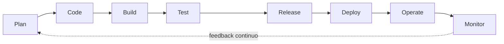

# Sesión 1 · Diagrama del ciclo DevSecOps propuesto

**Entregable:** diagrama del ciclo DevSecOps (PDF de 1 página + subida al repositorio).
**Archivo:** [`ciclo-devsecops.pdf`](ciclo-devsecops.pdf)

Incluye las 8 fases, al menos 1 herramienta por fase y el rol responsable de cada control.

| Fase | Control de seguridad | Herramientas | Responsable |
|---|---|---|---|
| Plan | Modelado de amenazas (STRIDE) y requisitos de seguridad | Threat Dragon, MS Threat Model | Arquitecto · PO |
| Code | SAST y detección de secretos | Semgrep, Gitleaks, SonarQube | Desarrollador |
| Build | SCA e imágenes firmadas | Trivy, Snyk, Cosign | Desarrollador · DevOps |
| Test | DAST sobre staging, pruebas de autorización | OWASP ZAP, Burp Suite | QA · Security |
| Release | Firma criptográfica del artefacto y SBOM | Sigstore, Syft, CycloneDX | DevOps |
| Deploy | IaC scanning, políticas cloud y control de acceso | Checkov, tfsec, OPA | DevOps · Cloud |
| Operate | Gestión de secretos, WAF, hardening y parches | Vault, ModSecurity, Falco | Operations · SRE |
| Monitor | SIEM, telemetría, alertas y respuesta a incidentes | ELK, Grafana, Wazuh | SOC · SRE |

## Dónde está cada fase en SecurePipeline

| Fase | Implementado en el repo | Sesión |
|---|---|---|
| Plan | `docs/threat-model.md`, `docs/security-stories.md` | 3 |
| Code | Job `secret-scan` (Gitleaks) y `sast` (Semgrep) en `ci.yml` | 5, 7 |
| Build | Job `sca` (Trivy) + SBOM CycloneDX en `ci.yml` | 6 |
| Test | Pruebas unitarias hoy; DAST (OWASP ZAP) en Sesión 8 | 4, 8 |
| Release / Deploy / Operate / Monitor | Pendientes de sesiones futuras | — |
